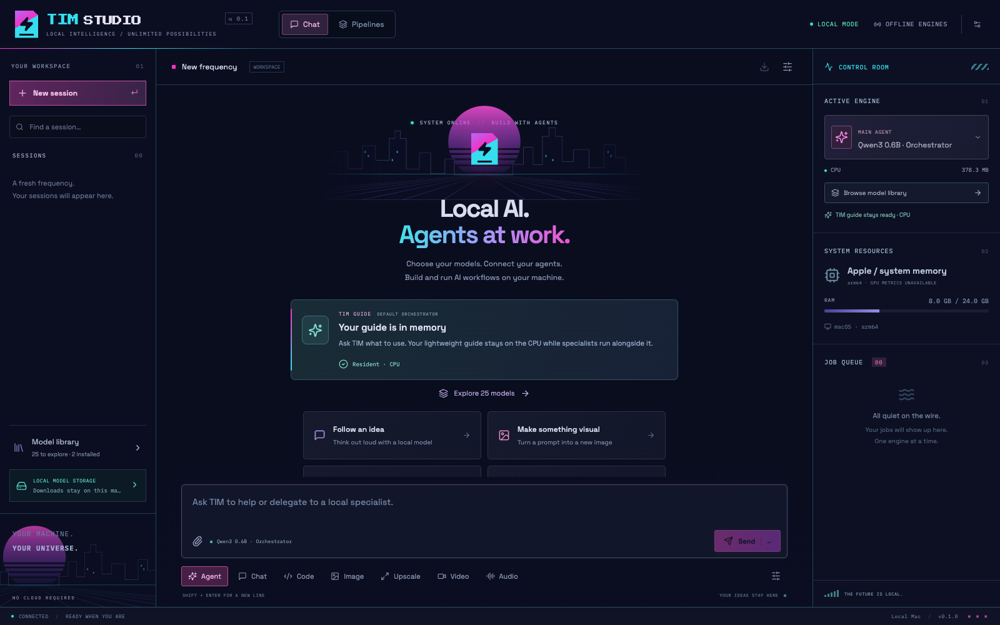
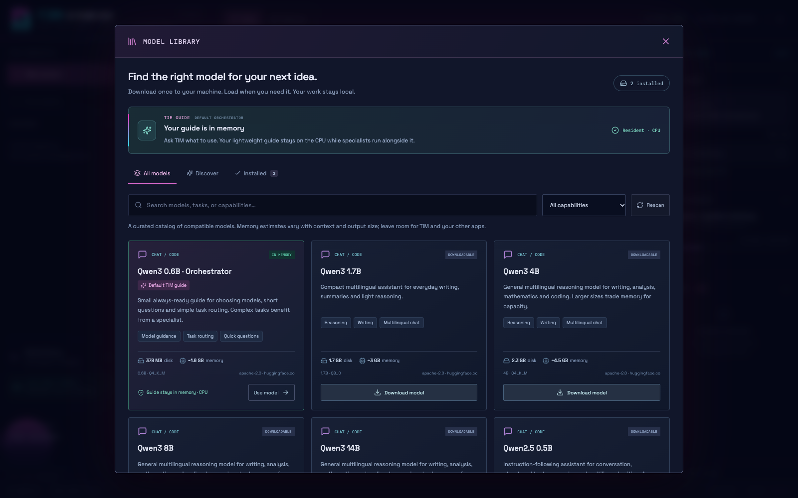
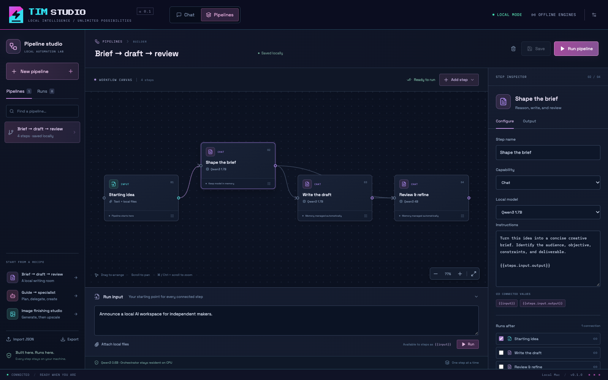
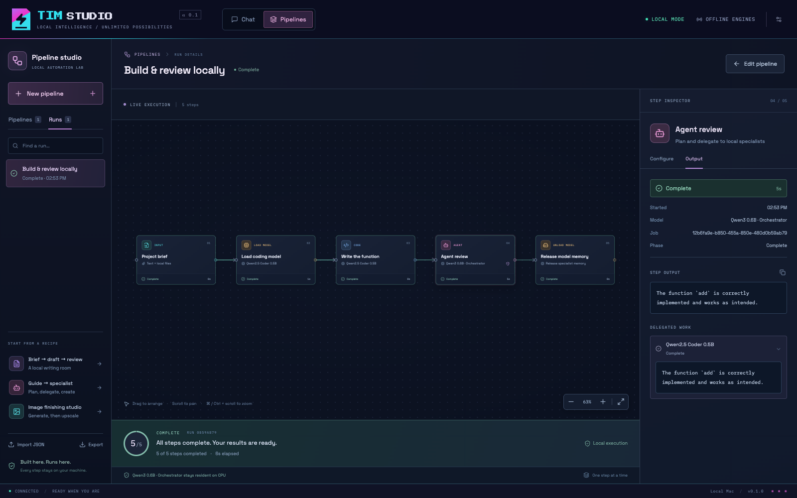

# TIM Studio

A local AI workspace for downloading models, running agents, and building visual pipelines on your own machine. Chat with a resident guide, choose specialist models, and inspect each step as a workflow runs.

TIM Studio is a desktop alpha for **Windows, macOS, and Linux**. Models can be downloaded into its local data folder or referenced in place from an existing TIM library. Once the required models and engines are installed, inference runs locally.

## Screenshots

Interface previews use example data. The completed pipeline shows saved results from a real local run.

**Local AI workspace** — chat with TIM, choose a capability, and open the model library or pipeline builder.



**Model library** — explore the 25-model catalog, compare specialties and memory estimates, and manage local downloads.



**Pipeline builder** — connect model-specific steps and configure their instructions, inputs, and memory policies.



**Local execution** — inspect completed steps and delegated work from the five-step coding and review example.



## Run on Windows, macOS, and Linux

| Platform | Launcher from this repository | Packaged app |
| --- | --- | --- |
| Windows | Open [Start-Windows.bat](Start-Windows.bat). | Extract the Windows ZIP and open `TIM Studio.exe`. Keep the entire extracted folder together. |
| macOS — Apple Silicon or Intel | Open [Start-Mac.command](Start-Mac.command). | Extract the matching arm64 or x64 ZIP and open `TIM Studio.app`. |
| Linux x64 | Run `./Start-Linux.sh`, or `sh Start-Linux.sh` if executable permissions were not retained. | Mark the AppImage executable and open it. An unpacked build can also run `release/linux-unpacked/tim-studio`. |

The launchers prefer a matching local packaged build when present. To run from a fresh source checkout on any platform, install **Node.js 24 or newer**, then run these commands in the project folder:

```sh
npm ci --include=dev
npm run setup:desktop
npm run desktop
```

After setup, use the platform launcher above. The Mac launcher can also install missing development dependencies automatically; Windows and Linux launchers expect the source environment to be prepared first.

The packaged app includes its JavaScript runtime and interface and does not need npm or Python to launch. A fresh setup downloads a lightweight guide and chat engine when needed. Existing `Coding-Models` and `Portable-Local-Studio` folders remain optional sources for models and media engines; Settings can point to a different library root.

Browser mode works on all three platforms: run `npm run build`, then `npm start`, and open [http://127.0.0.1:4317](http://127.0.0.1:4317).

## Platform targets and actual validation

| Platform | Desktop packaging | Existing TIM engine support | Validation here |
| --- | --- | --- | --- |
| Windows 10/11 x64 | Unpacked app and ZIP | CPU/Vulkan chat, CUDA/Vulkan/CPU diffusion, Vulkan upscale, CPU Whisper | Native launch, chat, image, upscale, and spoken-audio transcription passed |
| macOS Apple Silicon | arm64 app ZIP | Existing arm64/Metal engines; the TIM package documents macOS 26+ for its chat/video binaries | Development app, guide, coding specialist, concurrent residency and a five-step local pipeline passed locally; ZIP packaging and native desktop startup passed in CI on October 26, 2026; packaged-app first-run setup and media inference not tested |
| macOS Intel | x64 app ZIP | Requires separate x64 runtime packs; the supplied TIM Mac engines are arm64 | Build workflow configured; inference not tested |
| Linux x64 | AppImage | Existing CPU/Vulkan engines; TIM documents Ubuntu 24.04-compatible systems with glibc 2.38+ and required GPU/OpenMP libraries | AppImage packaging and native desktop startup passed in CI on October 26, 2026; model inference not tested on Linux |

Native packages must be validated on their own operating systems. `.github/workflows/desktop.yml` runs tests, native packaging, and desktop startup checks on all four architecture targets. It uploads build artifacts and disables release publishing. See [GitHub Actions](https://github.com/The-inside-man/smooth-operator/actions) for current results; the local validation above does not establish packaged-app inference compatibility on every platform.

## Main conversational agent

The reusable [orchestrator agent specification](ORCHESTRATOR.md) documents its role, portable model instructions, application procedures, tool contract, and the steps for replacing and validating the guide with another local model. Selecting a replacement in TIM retains the runtime application guide; the Markdown is a repository handoff document rather than an automatically loaded prompt.

Agent is the default entry mode. On a fresh setup, TIM installs **Qwen3 0.6B Q4_K_M** as the default guide and obtains a compatible llama.cpp chat engine when none is available. The guide's model download is about **397 MB**, with an estimated **1.6 GB** working memory at its fixed 4,096-token context. This is a planning estimate, not a guarantee of total process memory or model quality. The guide helps explain model strengths, memory needs and suitable specialists. Settings can select a different compatible **Main agent model**.

The guide runs in its own CPU process, uses at most four threads and stays loaded while a specialist runs. A separate process loads a chosen chat/code specialist into memory. Before media work, that specialist is unloaded to free memory; the guide remains available for synthesis. Catalog memory estimates include room to plan around the guide, and oversized catalog models are rejected using the computer's total memory. Available free memory and actual engine overhead can still cause a load to fail.

Agent loads enable `--jinja`, as required by the [llama.cpp function-calling documentation](https://github.com/ggml-org/llama.cpp/blob/master/docs/function-calling.md). A manually supplied engine must support this flag and the selected model must have a compatible template; no custom template is downloaded.

An agent turn can call available registered chat/code, image, video, upscale and transcription specialists, then synthesize their actual returned text and artifact metadata. One specialist runs at a time inside the parent queue slot. Only attachments from the current turn and that turn's generated artifact IDs can be used as tool inputs. The conversational model has no shell, arbitrary-file, cloud or network tool; downloads are managed separately by the application. The agent cannot visually inspect generated images/videos or hear audio; the UI labels this limitation.

Settings bound each turn to 1–8 specialist calls (default 4) and 30–1800 seconds (default 600). Cancel applies to the whole turn, including the current specialist. Malformed or unavailable tool calls fail visibly; engine failures return structured errors to the main model. Completed child artifacts remain visible when a later step fails. Interrupted turns are not replayed on restart. Long conversations or results can still exceed a model's context window and fail; automatic context compaction is not implemented.

TIM receives a versioned application guide from `server/app-guide.mjs`. Help questions retrieve concise instructions for the relevant controls: pipeline creation, model downloads and memory, Chat, or Settings. For application help, the guide receives the current manual and bounded user context instead of the full model catalog or outdated assistant guesses; it is offered no execution tools. Normal model recommendations and explicit specialist delegation retain their existing routes. Live application facts are limited to counts and status, without copying private pipeline instructions, paths, or conversations into the manual. The guide can explain controls but cannot click the interface or create/run saved pipelines from chat.

This supplies application knowledge at run time; it does not change the model's weights. Conversations and SYSTEM PROMPT edits do not automatically train the model. There is no fine-tuning or learned-memory workflow in this alpha. Update the shipped guide alongside interface changes, and use the explicit `npm run smoke:app-help` check to test the installed guide against application questions without downloading weights or modifying user conversations.

Automated validation uses mocked model responses and temporary local fixtures. A real Mac check also verified a catalog recommendation, a structured call to the installed coding specialist, returned code and concurrent guide/specialist residency. This does **not** establish that every catalog model supports tools, that all requests route reliably, or that generated media is correct. Existing packaged executables must be rebuilt to include these source changes.

## Browse, download and load models

Model Library includes an offline catalog of **25 models**: five Qwen3 assistants, ten Qwen2.5 general/chat and coding assistants, seven Whisper speech-to-text variants, and three image checkpoints (DreamShaper 8, CyberRealistic 8 and Juggernaut XL 9). Each entry describes what it is good for, parameter size or architecture, quantization, download size, estimated memory, license and a link to its source. Search and filters work before a local library is connected. The catalog is curated and bundled with the app; it is not a live search of every model online.

Choose **Download** to save a model to this computer. Downloads show progress, support cancellation and keep partial files for a resumable retry. Interrupted downloads stay paused after restart until retried. The app checks the pinned Hugging Face revision, expected byte count and SHA256 before exposing an installed model. Multi-file GGUF models become available only after all shards are verified. Errors such as a network interruption, checksum mismatch or full disk are shown in the download state.

Installed chat and code models can be loaded into memory from the library and unloaded when finished. Media models load when a corresponding task runs. The default guide stays loaded independently. Downloading an image checkpoint or Whisper model installs its weights; it still needs a matching external image or Whisper engine pack. Automatic engine installation currently covers **chat only**. Additional image-editing bundles, video and upscaling continue to use external TIM engine/model bundles and their existing recipes.

First-time guide setup needs an internet connection. The catalog stays visible if setup fails; retry setup or a model download after correcting the reported issue. Once the required engines and models are installed, inference runs locally without a network connection. Set `TIM_AUTO_SETUP=0` before starting the app to disable automatic guide setup, for example during offline validation.

Sources: [Qwen3 model capabilities](https://huggingface.co/Qwen/Qwen3-0.6B), [default Unsloth GGUF quantization](https://huggingface.co/unsloth/Qwen3-0.6B-GGUF), [Qwen2.5 Coder GGUF models](https://huggingface.co/Qwen/Qwen2.5-Coder-7B-Instruct-GGUF), [Whisper.cpp weights](https://huggingface.co/ggerganov/whisper.cpp), and [official llama.cpp engine releases](https://github.com/ggml-org/llama.cpp/releases). Model and engine versions are pinned in the source catalog and runtime installer. Their original licenses apply; the Qwen2.5 3B entries use the Qwen Research License rather than Apache 2.0.

## Local pipeline builder

Open **Pipelines** to build a local workflow on an interactive graph. Start with a blank pipeline or a writing, agent, or image-finishing recipe. Drag steps, connect dependencies, pan and zoom, then select a step to choose its model, instructions, generation settings, and memory policy. Saved pipelines and their run history stay on this computer. The run inspector shows each step's phase, elapsed time, actual streamed text, returned files, errors, and delegated agent work. Media progress appears when the engine reports it; otherwise the step shows its current phase.

Supported steps are **Input, Agent, Chat, Code, Image, Video, Upscale, Transcribe, Load model, and Unload model**. Agent steps use the resident TIM guide by default and can delegate to registered local specialists. Selecting another chat model for an Agent step gives that agent its own process; the guide continues to run separately. Code steps generate text and do not execute it. Media steps need the corresponding installed engine and compatible model recipe.

Pipelines are dependency graphs with at most 32 steps. A step runs only after every dependency completes, and one inference step runs at a time through the same queue as conversation jobs. Branches express dependencies; they do not run models in parallel. Cycles, unknown steps, and references to unrelated branches are rejected. Use `{{input}}` for the run's input and `{{steps.draft.output}}` for the text returned by an ancestor whose ID is `draft`. When no explicit ancestor variable is used, direct predecessor text is appended automatically. References are substituted once as literal data. Images and other supported files can come from run attachments or successful ancestor artifacts; arbitrary paths cannot be supplied.

The memory policies apply to specialist processes:

- **Automatic:** load or switch models as needed and release specialists after computation. A matching explicit Load model step can prepare the next computation in advance.
- **Keep loaded:** leave the chat model or custom agent resident until incompatible work, an Unload model step, or other work needs that process. This does not keep a completed media subprocess running.
- **Unload after this step:** release specialist and custom-agent processes after the output has been saved.

Load model steps prepare chat/code models and retain them for a following step. Media engines load during their own steps and exit afterward. The guide remains resident under every policy and cannot be unloaded by a pipeline. Admission checks combine the catalog estimates for the guide, custom agent, and active specialist with working space; imported models use a weight-based estimate when their size is known. Actual memory pressure can still cause a load to fail.

Choose **Pause** to stop between steps after the active step finishes, **Resume** to continue a paused or interrupted run, or **Cancel** to abort current work and skip later steps. Each run keeps an immutable copy of its definition, so editing a saved pipeline does not change that run. Completed outputs survive interruption; unfinished steps restart from their beginning only after an explicit resume. Failed or cancelled runs require a new run. There are no conditional branches, loops, automatic retries, schedules, or automatic publication to an online platform in this version.

**Export** downloads the definition as TIM pipeline JSON with `schemaVersion: 1`; **Import JSON** opens a new editable copy. An export contains its name, description, node positions, dependencies, model IDs, instructions, settings, and memory policies. It does not bundle model weights, engines, attachments, run results, or third-party credentials. Install matching local models and review their selections after importing. The definition is a TIM format, not a deployment package for a hosted agent platform.

Pipeline agents have the same bounded registered specialist tools as conversational agents. They cannot run arbitrary shell commands, inspect arbitrary folders, call cloud services, or add new tools through imported JSON or model-generated text. Outputs are bounded, agent steps have a time limit and a limit of eight specialist calls, and results are passed as text and artifact metadata rather than visual or audio inspection. Long prompts may still exceed a selected model's context. Automated pipeline tests use local fixtures and mocked model responses. A real Mac run also completed input → model load → code generation → delegated agent review → model unload, using Qwen3 0.6B and Qwen2.5 Coder 0.5B. The review specialist received the actual generated code; the same guide process remained resident and the specialist was unloaded at the end. This checks execution and data flow, not general model quality or generated-code execution. Broader media compatibility and memory-pressure validation remain necessary.

## Working features

- Single-window chat and code generation with streaming responses.
- Local sessions, text/code attachments, session export, and editable system prompt, temperature, response length, and context size.
- A searchable online-download catalog with model specialties, size/memory guidance, progress, cancellation, resumable retry and verified local installation.
- A default lightweight guide that stays loaded alongside a specialist, plus explicit chat/code model loading and unloading.
- A graphical local pipeline builder with model-specific steps, agent delegation, memory policies, live run details, saved definitions, JSON import/export, pause/resume, and cancellation.
- Existing-library model discovery, missing-companion diagnostics, model selection, and explicit runtime selection.
- Image generation and image-to-image/reference editing recipes for known SD, FLUX.2, and Qwen bundles.
- Image previews, save/export, and reuse as input to editing, video, or 4× Real-ESRGAN upscaling.
- WAV transcription using Whisper, displayed in the conversation and saved as text.
- Wan video recipe and inline WebM playback. **A complete video run is unverified:** this computer reported a device-read error when reading the existing Wan weights, independently reproduced by a checksum read outside the sandbox.
- One inference job at a time, queued work, cancellation, interrupted-job recovery, and automatic specialist chat-model unloading before media work while the guide stays resident.
- Real NVIDIA telemetry where available, system memory elsewhere. Auto mode skips CUDA when no NVIDIA device is detected and can retry failed chat initialization on CPU.
- All interface fonts and assets bundled locally. No accounts, telemetry, cloud inference or content filtering. Initial guide/engine setup and requested model downloads use the internet; inference uses local engines.

“Available” means the required files, runtime, and known recipe were found. It does not guarantee that a model fits available memory or that its architecture is supported by that exact engine build. The library records successful/failed runs for the current OS and architecture.

## Still to implement or validate

- Speech synthesis, microphone conversation, audio denoising/music generation, and dedicated restoration/cleanup tools.
- Broader validation of the default guide's recommendations and tool choices. Each additional model still needs compatibility and quality validation with the installed engine.
- FLUX 3's separate engine recipe, arbitrary model-family plugins, vision chat/projector pairing, and RedMars integration.
- Full validation of larger chat models, image-editing variants, video, memory-pressure behavior, and all Mac/Linux native workflows.
- Signed/notarized release packages and packaged, tested engine bundles for each platform. The current Windows alpha uses the engine files already on TIM.

## Portable storage

Packaged apps create `TIM-Studio-Data` beside the executable, beside the `.app` bundle on Mac, or beside the AppImage. It contains `sessions.json`, `jobs.json`, `settings.json`, `downloads.json`, `pipelines.json`, `pipeline-runs.json`, `uploads/`, `outputs/`, `work/` logs, and Chromium's `desktop/` state. Pipeline definitions and run snapshots are saved atomically alongside conversations. Use a writable folder. Browser mode defaults to this repository's `data/` directory.

Downloaded weights live in `models/<catalog-id>/`, alongside an installation receipt. Partial files end in `.part` and remain available for retry after cancellation or interruption. The app uses stable `catalog:<catalog-id>` identifiers, so these models do not need a separate TIM library root. Engine setup uses `setup/` temporarily and installs the verified chat runtime under `runtimes/<platform>-<arch>/chat/cpu/`. Model weights and engine binaries are not bundled into the source or desktop alpha packages.

Optional environment variables:

- `TIM_LIBRARY_ROOT`: root containing `Portable-Local-Studio` and `Coding-Models`.
- `TIM_DATA_DIR`: explicit data directory, including when testing.
- `TIM_HOME`: portable desktop home directory; its data lives in `TIM-Studio-Data`.
- `TIM_AUTO_SETUP`: set to `0` to disable automatic guide/engine setup on app startup.
- `PORT`: browser server port; desktop mode selects a free port automatically.

Discovery handles Windows drive letters, `/Volumes` on Mac, and common `/media`, `/run/media`, and `/mnt` locations on Linux. Saved model identifiers use relative paths. Moving TIM to another mount point does not change those identifiers.

New architecture-specific engine packs can live in either:

```text
TIM-Studio-Data/runtimes/<platform>-<arch>/<engine>/<backend>/<executable>
TIM/TIM-Studio/runtimes/<platform>-<arch>/<engine>/<backend>/<executable>
```

Platforms: `win32`, `darwin`, `linux`. Architectures: `x64`, `arm64`. Engines: `chat`, `image`, `video`, `upscale`, `transcribe`. Backends: `cpu`, `cuda`, `vulkan`, `metal`. Executables: `llama-server`, `sd-cli`, `realesrgan-ncnn-vulkan`, `whisper-cli`, with `.exe` on Windows. Keep each engine's dependent libraries beside it. Upscaling also needs `models/realesrgan-x4plus.bin` and `.param` beside the executable.

## Develop and package

Use Node.js 24 or newer. Dependency setup requires a network connection; running the built app with installed models does not.

```sh
npm ci
npm run setup:desktop
npm run dev
# or
npm run desktop
```

```sh
npm test
npm run build
npm run pack
npm run dist
```

`npm run test:pipelines-ui` checks the graph editor and run controls with browser fixtures. `npm run smoke:pipelines` explicitly runs the five-step **Build & review locally** example using the already installed small guide and coding model; it saves the recipe and run history in `TIM-Studio-Data` and downloads no weights.

Build on the target operating system. `Start-Mac.command` and `Start-Linux.sh` launch local packages if present and otherwise use the development environment. On Linux, run `sh Start-Linux.sh` if the drive does not retain executable bits; native binaries still need a mount that permits execution.

On a fresh Mac checkout, open `Start-Mac.command` with Node.js 24+ installed. If no matching packaged app is present, the launcher installs missing development dependencies and the Electron runtime before building and opening the app. This first-time setup needs an internet connection. The app then prepares its default guide and chat engine; additional models can be downloaded from Model Library. Media engines remain separate.

## Catalog and guide validation on October 26, 2026

- Catalog entries were checked against publisher model cards and Hugging Face metadata for exact filenames, immutable revisions, byte sizes, SHA256 values and licenses.
- All 135 automated tests passed, including application-guide retrieval and help-only tool boundaries, catalog integrity and resumable downloads, strict native tool calls, specialist source context, graph validation, ancestor data flow, model reuse, memory admission, shared queue serialization, manual-load/resume coordination, cancellation and explicit restart recovery. Test fixtures use tiny local byte streams and mocked model responses; they do not download real weights.
- Startup trusts the app's verification receipt for unchanged local files and rechecks hashes when file metadata changes. Existing-library discovery remains independent of these receipts.
- A real Mac run downloaded and verified Qwen3 0.6B and Qwen2.5 Coder 0.5B, obtained a coding recommendation, delegated a Python task through a native structured tool call and returned the specialist's code. The same guide process stayed resident throughout specialist loading and execution. Observed resident memory was about 1.45 GiB for the guide and 0.63 GiB for the coding process; these are one-machine observations, not limits.
- A clean automatic download of the pinned official Mac arm64 chat runtime passed checksum verification, extraction and executable startup after its temporary files were removed.
- The lightweight guide receives a task-relevant catalog shelf for recommendations. Direct requests such as “use the coding specialist” use a concise dispatch prompt and require an actual call to the matching registered function on the first step; a missing call fails visibly. Specialists also receive bounded original source context. These checks do not establish universal routing reliability.
- The pipeline browser check passed graph editing, connections, import/export, uploads, live output, pause/resume/cancel, interruption history, and responsive layouts. Unsaved work survives switching to Chat; selecting a pipeline queue job opens that exact run. The desktop startup and isolated preload check also passed on Mac.
- The installed Qwen3 0.6B guide answered the reported "guild a pipeline" question with the actual builder controls, explained the complete model download/load workflow, and accurately stated its lack of direct interface control. This real check used isolated conversations, no model downloads, the same resident guide process, and no specialist execution. It validates these examples rather than guaranteeing every answer from a small model.
- Complete packaged-app first-run setup and real-model validation of the new catalog/guide features on Windows and Linux remain pending. Native startup and packaging results are reported separately above. The Windows inference evidence below predates these features and remains evidence for the earlier adapters only.

## Validation performed on October 22, 2026

- TypeScript checking and production build passed.
- Automated tests cover OS/architecture resolution, incomplete bundles, literal subprocess arguments, invalid parameters, serialized atomic saves, cancellation, sequential execution, HTTP isolation, output range requests, and path traversal rejection.
- Browser automation checked model search/selection, settings, generation controls, and compact layout. No page errors or external requests were observed.
- Both development Electron and the final packaged Windows executable passed native startup, isolated preload API checks, and a real streamed Qwen2.5-Coder-1.5B response.
- DreamShaper generated a 512×512 image; Real-ESRGAN produced a 2048×2048 output.
- Whisper transcribed a locally recorded spoken sentence accurately.
- Wan model loading failed with a disk/device read error; a separate checksum read failed too. No repair, overwrite, or replacement download was attempted.

Test outputs and raw screenshots are under `artifacts/`, excluded from source control. Selected README images are tracked in `docs/screenshots/`. `scripts/smoke-models.mjs` explicitly exercises real engines; ordinary `npm test` uses temporary test data and does not run model inference.

## Architecture

`src/` holds the React/TypeScript interface, including the interactive pipeline workspace. `desktop/` owns the Electron window and limited native file-dialog bridge. `server/` provides a loopback-only API, bundled model catalog, verified downloads, portable runtime setup/resolution, separate guide and specialist chat processes, a serialized inference queue, atomic JSON storage, and engine adapters. `server/pipelines.mjs` validates and persists dependency graphs and run snapshots; `server/pipeline-executor.mjs` runs their steps inside the existing inference queue with local settings and model-memory controls. Model-generated text is rendered as text/code, not executable HTML. Native processes receive argument arrays rather than shell command strings.

Backend integrations are replaceable, which leaves a defined place for RedMars when its runtime contract is ready.

## License

TIM Studio's original source code and documentation are available under the [MIT License](LICENSE). The license is also included in future desktop builds.

Downloaded models, external engines, fonts, and other third-party components retain their own licenses; the project's MIT license does not replace those terms. Model cards in the library link to their sources and identify their licenses.

## Third-party components

React, Electron, Vite, Lucide, Fontsource fonts, and their dependencies retain their own licenses in the installed packages. Local engine/model files remain external and retain their original licenses. No upstream Portable-Local-Studio source or model weights are bundled into this alpha.

References: [Electron installation](https://www.electronjs.org/docs/latest/tutorial/installation), [Electron process isolation](https://www.electronjs.org/docs/latest/tutorial/security), [GitHub native runner targets](https://docs.github.com/en/actions/reference/runners/github-hosted-runners).
